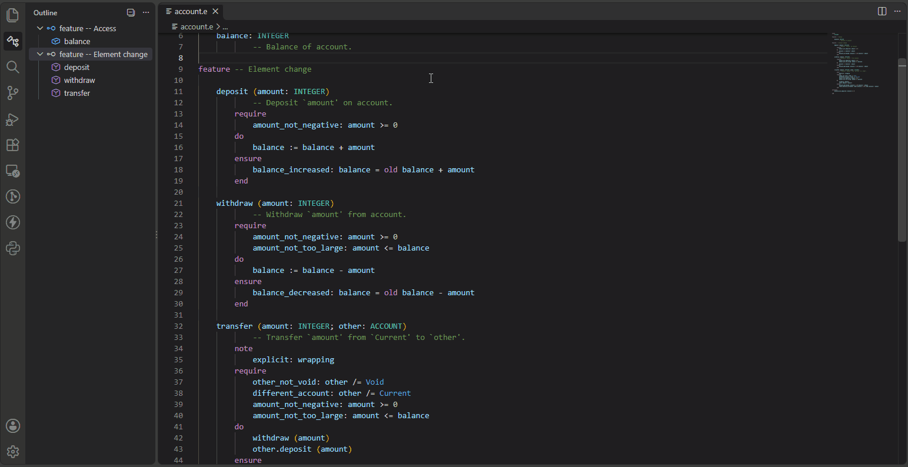
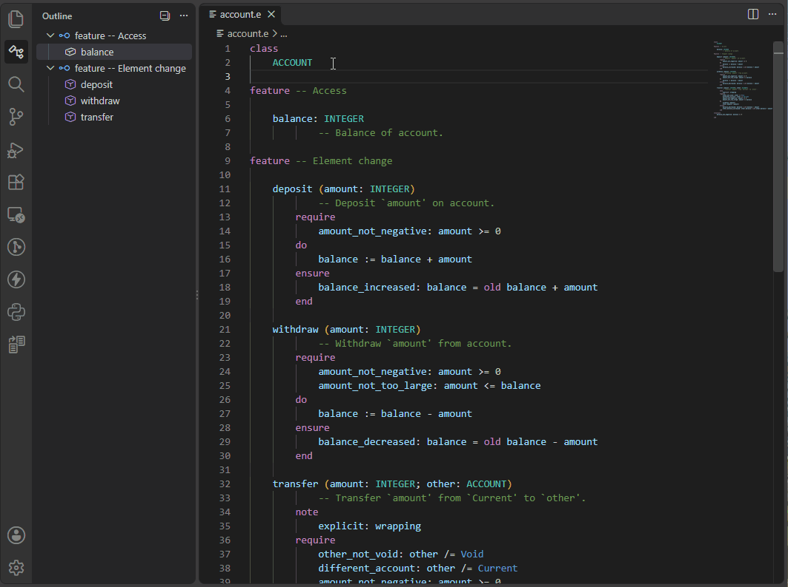

# Class Contract Views

The Eiffel VS Code extension can show the **contract view** of a class.
The contract-view of a class is a pretty-printed view of its class text
where internal implementation details are hidden. Therefore what is shown
is not valid Eiffel code, but rather an interface representation of the
class, also known as *short* form. Only exported features, their pre-
and postconditions, class invariants, and exported creation procedures
are retained. Assertions containing calls to non-exported features are
also omitted. 

## Contract View

From the contextal menu:

- Select **Class and Feature Views**, and then
- Select **Show Contract View**

The contract view of the class is displayed in a separate read-only 
editor. Code navigation is available like in full class texts. And
the label of the editor tab indicates that this is the **Contract View**
of the class.

## Flat Contract View

The contract view shows only features and invariants declared in the class
itself, whereas the flat contract view, also known as *flat short* form,
also includes inherited features and invariants.

From the contextal menu:

- Select **Class and Feature Views**, and then
- Select **Show Flat Contract View**

## See also

- [Code Navigation overview](../README.md#-code-navigation)
